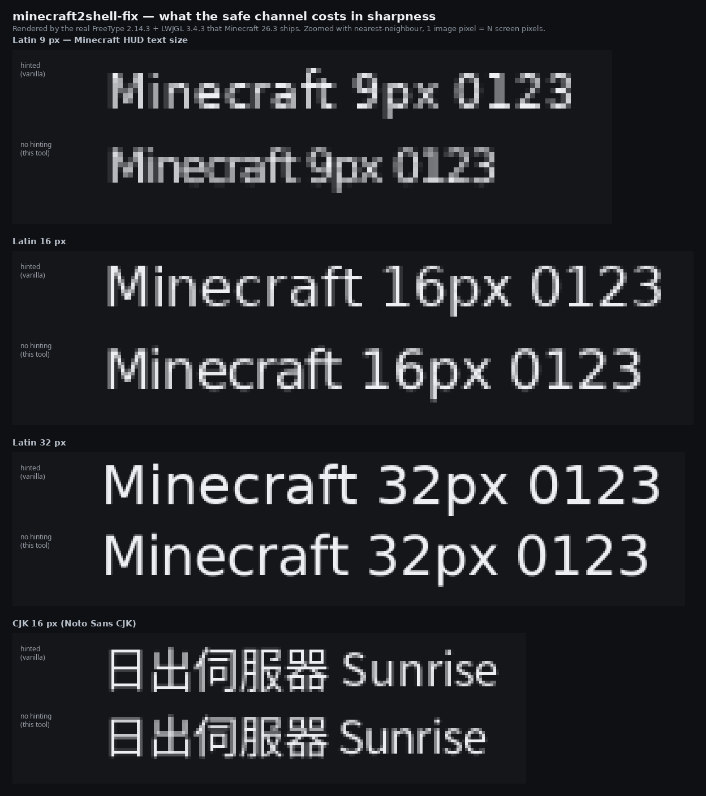

# minecraft2shell-fix

[](https://github.com/Ctrl-Creeper/minecraft2shell-fix/releases)
[](LICENSE)
[](#am-i-affected)
[](https://github.com/Ctrl-Creeper/minecraft2shell-fix/actions)

A client-side stopgap against the Minecraft **"server resource pack font" remote code execution**
([`bikini/minecraft2shell`](https://github.com/bikini/minecraft2shell)). It stops FreeType from running
the bytecode inside fonts, which is what the attack needs. The cost is slightly softer small text.

This is a fork of [`sunrisemc-tw/minecraft2shell-fix`](https://github.com/sunrisemc-tw/minecraft2shell-fix).
Version 2.2.0 hardens the guard and makes the Forge and NeoForge builds actually work. The changes are
offered upstream in [sunrisemc-tw/minecraft2shell-fix#2](https://github.com/sunrisemc-tw/minecraft2shell-fix/pull/2).

## Current status (2026-11-25)

- **Minecraft 26.x is fixed by Mojang.** The library versions for 26.1 through 26.4-pre-1 now point
  to Mojang builds of FreeType **2.15.0**, which corrects the `Ins_SHZ` bug. The official launcher and
  Prism Launcher both download them. You don't need this tool on 26.x unless a launcher or modpack pins
  an older LWJGL.
- **Minecraft 1.20.5 – 1.21.11 are still vulnerable.** They ship LWJGL 3.3.3 with FreeType 2.13.2 and
  have not been updated. If you play these versions on servers you don't fully trust, install this
  tool or decline server resource packs.
- **Update from 2.1.0 or older.** 2.2.0 includes a security hardening of the guard itself.

## Disclaimer

This is a temporary workaround, not an official Mojang fix. It may have false positives and false
negatives, and it cannot guarantee that it blocks every attack or that any warning it shows is
correct. The authors accept no liability for any direct or indirect loss; all responsibility rests
with the user. If you do not agree, **do not install it — decline every server resource-pack request
instead.**

## The problem

A Minecraft server can make players download a resource pack, and a resource pack can contain
TrueType fonts. Minecraft 1.20.5 and later render those fonts with FreeType. In FreeType before 2.15.0,
the `SHZ` instruction in a font's hinting bytecode can write past the end of a heap buffer. The
published exploit uses that to take over the client process when the game draws a single character
with the font. Its demo opens the calculator on Windows, but the same technique can run anything.

The exploit is traced step by step in [docs/EXPLOIT-ANALYSIS.md](docs/EXPLOIT-ANALYSIS.md).

## Am I affected?

Checked against Mojang's version manifest and by loading the native libraries:

| Minecraft | FreeType it loads | Vulnerable | This tool |
| --- | --- | --- | --- |
| 26.1 – 26.4 pre-releases | 2.15.0 (Mojang build) | no | not needed (harmless) |
| 1.20.5 – 1.21.11 | 2.13.2 (LWJGL 3.3.3) | **yes** | ✅ recommended |
| 1.20.4 and older | none (uses stb_truetype) | not this bug | ⛔ not applicable |

## What it does

**Default (`safe`): no font gets hinting.** Every glyph is loaded with `FT_LOAD_NO_HINTING |
FT_LOAD_NO_AUTOHINT`, so FreeType never runs a font's bytecode: no `fpgm`, no `prep`, no glyph
programs. The tool doesn't have to recognise the attack, so variants that haven't been published are
covered too.

The cost is sharpness. Top row = vanilla, bottom row = this tool, rendered with the real FreeType build
Minecraft ships:



- HUD-sized 9 px text changes the most, 32 px barely at all, and CJK text even less.
- On DejaVu Sans at 32 px, 72% of glyph bitmaps change, with a mean height difference of 0.88 px.

**A warning appears only for high-confidence hits**, i.e. fonts shaped like the published exploit:

```
This server's resource pack looks malicious (minecraft2shell). It was blocked and did not run;
fonts like this can execute arbitrary code on the client.

[Continue]  [Disconnect]
```

"Disconnect" leaves the server. The dialog doesn't try to show the command the font would have run:
the exploit builds it inside its bytecode, so it can't be recovered reliably.

## Install

Download from [Releases](https://github.com/Ctrl-Creeper/minecraft2shell-fix/releases). Pick one:

**Any launcher, including vanilla: Java agent.** This covers every FreeType call in the game,
including calls from other mods.

1. Download `mc2shell-fix-agent-2.2.0.jar` and put it somewhere permanent.
2. In the launcher, open your installation's JVM arguments (vanilla launcher: Installations → Edit →
   More options).
3. Append `-javaagent:/full/path/to/mc2shell-fix-agent-2.2.0.jar` and launch.

**Fabric:** put `mc2shell-fix-mod-2.2.0.jar` in `mods/`. No Fabric API needed.

**Forge / NeoForge:** put the same `mc2shell-fix-mod-2.2.0.jar` in `mods/`. On these loaders the mod covers
Minecraft's own font rendering. If you also run mods that call FreeType themselves, use the Java agent.

If the mod's hooks can't apply on your loader version, the game **stops at startup** with a message
telling you to use the Java agent. It never runs unprotected without telling you.

Tested in real clients (macOS, Apple Silicon):

| Route | Versions |
| --- | --- |
| Mod on Fabric | 1.21.10 |
| Mod on Forge | 1.20.6, 1.21.10 |
| Mod on NeoForge | 1.20.5, 1.20.6, 1.21.10, 26.3 |
| Agent | vanilla 1.21.10, Fabric 1.21.10 |

## Did it work?

Right after startup the log shows the hooks firing:

```
[m2sfix] guard active: FT_New_Memory_Face intercepted (policy=safe)
[m2sfix] guard active: FT_Load_Glyph intercepted (policy=safe)
```

If those lines are missing, the guard is not active. A font shaped like the published exploit adds:

```
[m2sfix] flagged font 11500c6f… (SUSPICIOUS): IDEF redefines point-zone opcode 0x36 in fpgm
```

The warning dialog opened on Forge, NeoForge 26.x, and Fabric with the agent. On obfuscated vanilla
1.21.x and plain Fabric 1.21.x the warning goes to the log instead. Either way the font is handled.

## Options

Add these as JVM arguments (`-D…`). The defaults are what most people want.

| Property | Default | Meaning |
| --- | --- | --- |
| `m2sfix.policy` | `safe` | `safe`: no font gets hinting · `detect`: only fonts whose bytecode could execute `SHZ` lose hinting (sharper, but about 11% of ordinary fonts are affected too) · `block`: refuse exploit-shaped fonts, otherwise like `detect` · `off` |
| `m2sfix.notify` | `true` | show the warning dialog |
| `m2sfix.log` | `true` | log one line per flagged font |
| `m2sfix.sha256.allow` | *(empty)* | comma-separated SHA-256 of fonts to always trust |

Full list and details: [docs/HOW-IT-WORKS.md](docs/HOW-IT-WORKS.md).

## Limitations

- It's a stopgap. The real fix is FreeType ≥ 2.15.0, which Mojang has shipped for 26.x only.
- Live testing was done on macOS (Apple Silicon) only. Windows and Linux use the same Java hooks but
  were not run live.
- The exploit itself was never run against a protected client. Protection rests on FreeType's code
  (every bytecode path is behind the hinting check) plus tests on the real native libraries.
- The warning dialog is signature-based, so a new variant may be neutralised without a warning. The
  dialog buttons were checked by unit tests, not clicked in a running game.

## Build

```
mvn -B clean package           # 98 tests (+1 Linux-only skip)
tools/verify-poc-pack.sh       # scans the published proof-of-concept pack: expects 144/144 flagged
```

Jars: `agent/target/mc2shell-fix-agent-*.jar` and `mod/target/mc2shell-fix-mod-*.jar`. Requires Java 21.

## More

- How the hooks and scanner work, with test data → [docs/HOW-IT-WORKS.md](docs/HOW-IT-WORKS.md)
- Per-loader test results → [docs/LOADERS.md](docs/LOADERS.md)
- `detect` mode rule and its cost → [docs/DETECT-MODE.md](docs/DETECT-MODE.md)
- The exploit, step by step → [docs/EXPLOIT-ANALYSIS.md](docs/EXPLOIT-ANALYSIS.md)
- Version history → [CHANGELOG.md](CHANGELOG.md)
- Reporting a bypass → [SECURITY.md](SECURITY.md)

## License

MIT. Original project by duckducktw / [sunrisemc-tw](https://github.com/sunrisemc-tw); 2.2.0 changes in
this fork.
