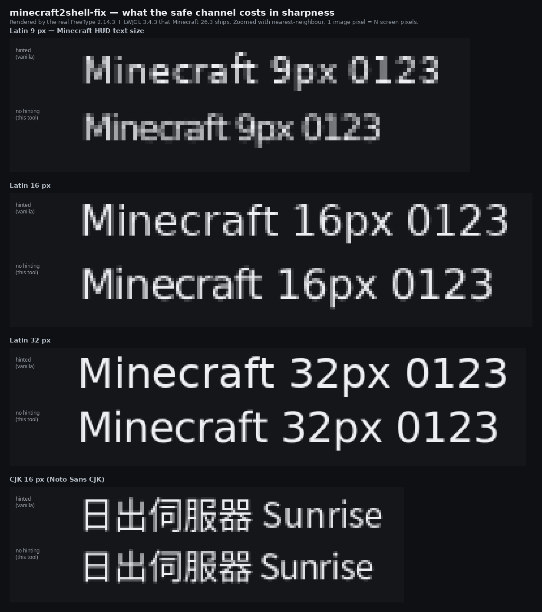

**English** · [简体中文](#简体中文)

Protects your client against the **Minecraft resource-pack font remote code execution**
([minecraft2shell](https://github.com/bikini/minecraft2shell)). A server can send a resource pack
with a crafted TrueType font, and in FreeType before 2.15.0 drawing a single character with it can
let the server run code on your computer.

## Who needs it

| Minecraft | FreeType it loads | Vulnerable |
| --- | --- | --- |
| 1.20.5 – 1.21.11 | 2.13.2 | **yes**: install this |
| 26.1 and newer | 2.15.0 (fixed by Mojang) | no |
| 1.20.4 and older | not used | not this bug |

## What it does

Every font is loaded with hinting turned off (`FT_LOAD_NO_HINTING | FT_LOAD_NO_AUTOHINT`), so
FreeType never runs the bytecode inside a font. That is the code the attack needs. The tool doesn't
have to recognise the attack, so unpublished variants are covered too.

The cost: small text looks slightly softer. Fonts shaped like the published exploit also trigger a
warning with a **Disconnect** button.

## Install

- **Fabric, Forge, NeoForge:** put the jar in `mods/`. No other mods needed. If the hooks cannot
  apply, the game stops at startup and tells you, so it never runs unprotected without saying so.
- **Vanilla launcher, or if you run other mods that call FreeType themselves:** use the Java agent
  from [GitHub Releases](https://github.com/Ctrl-Creeper/minecraft2shell-fix/releases) with
  `-javaagent:/path/to/mc2shell-fix-agent-2.2.0.jar`.

It works if the log shows `[m2sfix] guard active: FT_Load_Glyph intercepted` after startup.

Tested in real clients on macOS: Fabric 1.21.10, Forge 1.20.6 and 1.21.10, NeoForge 1.20.5, 1.20.6
and 1.21.10.

## Disclaimer

A temporary workaround, not an official Mojang fix. It may have false positives or negatives and
comes with no guarantee. If you don't agree, decline server resource packs instead.

Open source (MIT): [GitHub](https://github.com/Ctrl-Creeper/minecraft2shell-fix). Based on
[sunrisemc-tw/minecraft2shell-fix](https://github.com/sunrisemc-tw/minecraft2shell-fix), maintained independently.

---

## 简体中文

保护你的客户端，防御 **Minecraft 资源包字体远程代码执行漏洞**
（[minecraft2shell](https://github.com/bikini/minecraft2shell)）。服务器可以发送带有恶意 TrueType 字体的资源包；
在 FreeType 2.15.0 之前的版本中，只要用这个字体画出一个字，服务器就能在你的电脑上执行任意程序。

### 谁需要安装

| Minecraft | 使用的 FreeType | 是否受影响 |
| --- | --- | --- |
| 1.20.5 – 1.21.11 | 2.13.2 | **受影响**：请安装 |
| 26.1 及更新版本 | 2.15.0（Mojang 已修复） | 不受影响 |
| 1.20.4 及更早版本 | 未使用 | 不是这个漏洞 |

### 它做了什么

所有字体在加载时都关闭 hinting（`FT_LOAD_NO_HINTING | FT_LOAD_NO_AUTOHINT`），FreeType 就永远不会执行
字体里自带的字节码，而攻击正需要它。这个做法不需要先认出攻击，所以未公开的变种也能防住。

代价：小字会稍微变柔和。遇到与公开攻击特征相符的字体时，还会弹出警告，并提供 **断开连接** 按钮。

### 安装

- **Fabric、Forge、NeoForge：** 把 jar 放进 `mods/` 即可，无需其他前置模组。如果无法挂钩，游戏会在启动时
  停止并告诉你，绝不会在没有保护的情况下默默运行。
- **原版启动器，或装了其他会直接调用 FreeType 的模组：** 请从
  [GitHub Releases](https://github.com/Ctrl-Creeper/minecraft2shell-fix/releases) 下载 Java agent，
  在 JVM 参数中加入 `-javaagent:/路径/mc2shell-fix-agent-2.2.0.jar`。

启动后日志中出现 `[m2sfix] guard active: FT_Load_Glyph intercepted`，就表示已经生效。

已在 macOS 的真实客户端测试：Fabric 1.21.10、Forge 1.20.6 和 1.21.10、NeoForge 1.20.5、1.20.6 和 1.21.10。

### 免责声明

这只是临时解决方案，不是 Mojang 官方修复；可能存在误报或漏报，不提供任何保证。若不同意，请改为拒绝服务器的资源包。

开源（MIT）：[GitHub](https://github.com/Ctrl-Creeper/minecraft2shell-fix)。基于
[sunrisemc-tw/minecraft2shell-fix](https://github.com/sunrisemc-tw/minecraft2shell-fix)，现已独立维护。
